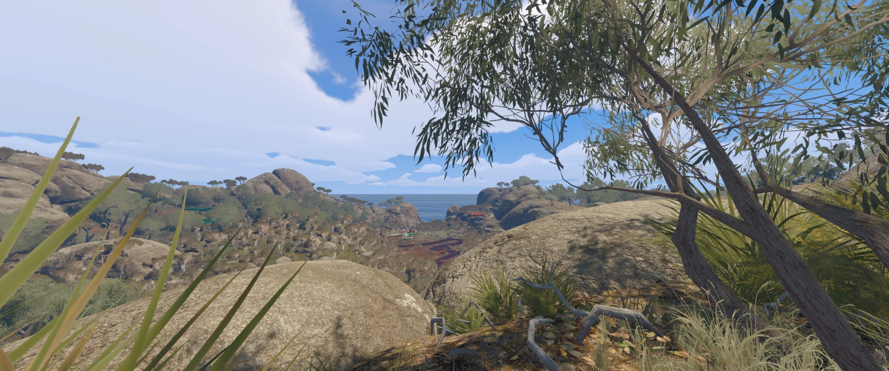
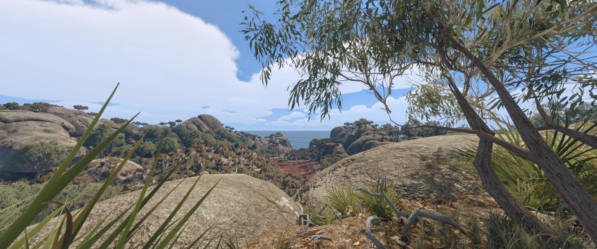

# Big Beautiful Walk 0.8.3

An unofficial graphics mod for **Big Walk** on Windows. It adds DLSS Super Resolution, FSR 3.1, FSR 4 and XeSS, DLSS5 Neural Rendering, Frame Generation and an in-game graphics panel, opened with the **Home** key, with controls for upscaling, shadows, vegetation, textures and more.

**[Download the Windows alpha](https://github.com/Pseudogiant-xr/Big-Beautiful-Walk/releases)** · [Installation](#install) · [Compatibility](docs/COMPATIBILITY.md)

Open the newest release and download `Big-Beautiful-Walk-<version>-alpha.zip` from **Assets**. Extract the whole ZIP and run **Setup.exe** with Big Walk closed.

**Game defaults: no DLSS, no Neural Rendering**

**Big Beautiful Walk: Extreme preset with DLSS and Neural Rendering**

This is an alpha, tested on one PC with an RTX 4090. See [compatibility](docs/COMPATIBILITY.md) for known limitations and [release readiness](docs/RELEASE-READINESS.md) for what was tested.

Big Beautiful Walk is not affiliated with or endorsed by House House, Unity or NVIDIA.

## Requirements

- Windows x64 and the Steam version of Big Walk, played on a monitor (no VR).
- A DirectX 11 GPU. NVIDIA RTX GPUs use DLSS. AMD and Intel GPUs use FSR 3.1 or XeSS through the OptiScaler bridge, which Setup installs for them automatically. The AMD/Intel path is experimental and has not been tested on AMD or Intel hardware yet.
- The [Microsoft Visual C++ v14 runtime for x64](https://aka.ms/vc14/vc_redist.x64.exe). Setup does not install it. See [Microsoft's runtime guidance](https://learn.microsoft.com/en-us/cpp/windows/latest-supported-vc-redist).

## Install

1. Install or repair the Visual C++ runtime.
2. Close Big Walk. Extract the whole release ZIP into its own folder.
3. Open **Setup.exe**, choose the folder that contains `Big Walk.exe`, and click **Install / Repair**. Setup downloads the BepInEx loader and the DLSS runtime from pinned sources and checks their SHA-256 hashes before it changes the game folder.
4. Optional extras are two checkboxes, both off by default:
   - the bridge, which adds alternative upscalers and NVIDIA, AMD and Intel frame generation;
   - the Neural Rendering model, RHI's community-hosted SF-v2 model. This also installs the bridge.

   For NR 310.9.16, download and extract the separate [optional NR pack](https://github.com/Pseudogiant-xr/Big-Beautiful-Walk/releases/download/v0.8.1-alpha/Big-Beautiful-Walk-NR-310.9.16.zip). Click **Use my NR 310.9.16 compatibility DLL...** and select `nvngx_dlssnr.dll` from that extracted pack (or your existing compatible DLL). Setup verifies the supported compatibility build by SHA-256 and uses it instead of the older download. See [the NR guide](docs/FRAME-GENERATION.md#nr-310916-local-import).

   Frame generation and Neural Rendering stay off until you turn them on in the game. Sources and terms for each component are in [the notices](THIRD_PARTY_NOTICES.md).
5. Start Big Walk normally. The first launch takes longer while BepInEx prepares its interop files.
6. Load into a private world and press **Home**. You should see **Upscaling active**. On the title screen it says **Waiting for a scene**, which is normal.

`Setup.cmd` runs the same installer in a console window, for troubleshooting and command-line use.

## First steps

- Start with DLSS Quality and Preset L, the tested baseline. Press **F8** to switch reconstruction off and on to compare. Home explains each tool’s benefit and how it works, and each graphics row describes what its setting changes.
- Try the Balanced, Quality and Extreme presets one at a time. **Game defaults** removes the graphics overrides. It does not change upscaling, frame generation or Neural Rendering, which have their own controls.
- Frame generation and Neural Rendering apply on the next launch. Choose them under **Home → Frame Gen** or **Neural**, quit the game normally, then start it again.

## Uninstall and troubleshooting

**Diagnose** in Setup checks the installed files. **Uninstall**, with the game closed, removes what Setup installed and restores the original files it backed up. Those backups live in the `.big-beautiful-walk` folder in the game directory, so don't delete it before uninstalling.

[Installation and recovery](docs/INSTALLATION.md) · [Graphics guide](docs/GRAPHICS.md) · [Upscalers and presets](docs/UPSCALERS.md) · [Compatibility and known issues](docs/COMPATIBILITY.md) · [Building from source](docs/BUILDING.md)

## Features

- **DLSS**, from Ultra Performance to native DLAA, with selectable render presets. Quality with Preset L is the tested baseline. DLAA and Ultra Quality are experimental.
- **Graphics overrides**, including shadow cascades, vegetation shadow range and an experimental 16384-pixel main shadow atlas. Extreme settings can cost a lot of performance and video memory.
- **Frame generation** (optional bridge), with NVIDIA, AMD and Intel profiles in **Home → Frame Gen**. On the test RTX 4090, NVIDIA FG looked best. AMD FG worked, with worse quality and performance. Intel FG generated frames but lowered the reported frame rate. See the [FG / NR guide](docs/FRAME-GENERATION.md).
- **Neural Rendering** (optional), using the RHI community download or a compatible model you already have. Setup can import the hash-verified NR 310.9.16 compatibility runtime you already have, including its new Lightweight FP8 model (preset B). The older SF-v2 download remains available. The new runtime has passed installer checks; rendering in Big Walk has not yet been tested. [The NR guide](docs/FRAME-GENERATION.md#neural-rendering) gives the exact version and source.
- **AMD and Intel GPUs (experimental)**: upscaling with FSR 3.1 or XeSS, plus AMD and Intel frame generation, all through the bridge. Options that need an NVIDIA GPU (DLSS, its model presets, NVIDIA frame generation and Neural Rendering) are greyed out with the reason.
- **FSR 3.1 and XeSS**, offered in Home when the bridge's requirements are met. FSR 4 shows as unsupported on the RTX 4090. The [feature matrix](docs/UPSCALERS.md) lists requirements and test status for each.

Not supported: VR, distance-field shadows and ray-traced shadows.

### Tested setup

Big Walk 1.6.0 (Steam build 25723723), Unity 6000.3.17f1, an RTX 4090 with driver 617.42, and the official NVIDIA DLSS SR 310.9.1 runtime. DLSS ran in-world without interruption. On a fresh BepInEx install, BepInEx downloaded the Unity libraries, generated 158 interop assemblies and loaded the mod, and the next launch reused those files. After that fresh install, the picture, movement and the Home and F10 menus all worked in a private world. See the [compatibility notes](docs/COMPATIBILITY.md).

## Dependencies and licensing

The release ZIP contains the mod's binaries, source, installer and notices. It does not contain game assemblies, game assets, NVIDIA runtime DLLs or a Neural Rendering model. Setup downloads the runtimes from the sources pinned in [dependencies.lock.json](packaging/dependencies.lock.json). [THIRD_PARTY_NOTICES.md](THIRD_PARTY_NOTICES.md) lists each component's licence and upstream source.

The project's own code is licensed under Apache 2.0. The Unity-adapted post-processing code and the third-party components keep their own terms, so Apache 2.0 does not cover the whole dependency stack. Attribution is on Home's **Credits and licences** page and, after installing, in the `BepInEx/BigWalkDLSS/notices` folder. [LICENSING.md](docs/LICENSING.md) covers each component's terms, and [the release checklist](docs/RELEASE-CHECKLIST.md) lists the maintainer checks still open.

## Reporting problems

Open a [GitHub issue](https://github.com/Pseudogiant-xr/Big-Beautiful-Walk/issues). Include the mod version, game version, GPU, driver, graphics API and the shortest log excerpt that shows the problem. Remove account names and personal paths from logs before posting them.

Author’s foreword and satire

Foreword:

G'day people, this is Big Beautiful Walk. The game is awesome and great fun with my mates, but the horrible jaggies and lack of graphics options galled me, so I decided to AI sloppify a fix to make it better!

I hope it makes your walk even more beautiful, and now for a bit of satire:

----------------------------------------------------------------------------------------

A Very Big, Very Beautiful Walk

Folks, let me tell you about this mod. Tremendous mod. People are saying it’s the most beautiful walk they’ve ever seen, and I’ve seen a lot of walks. Believe me.

Before this mod, the shadows were short. Sad! Three hundred metres, maybe. Now? Two thousand metres. Two thousand. Nobody’s ever seen shadows like this. The trees are saying, “Sir, thank you, we’ve never been shaded like this before.” True story.

And DLSS, which is a very smart technology, NVIDIA, great company, very rich. We put in Quality, Preset L. The best preset. Some people like Preset K. Low energy. We don’t talk about Preset K.

The installer? Perfect installer. Hashes everything. SHA-256, which is a big number, maybe the biggest. It refuses to run while the game is open. Very strong, very tough on running games. Other installers let anything happen. Not ours.

We had a junction problem, a total disaster left over from the previous administration, and we fixed it. Fast. Many people didn’t think it could be done.

Frame generation, folks: we made frames out of nothing. Intel’s frame generation, not so good, lost thirty frames, very unfair. But NVIDIA’s? Fantastic.

So download it. It’s free, which is a very good price. Make Big Walk Beautiful Again.

----------------------------------------------------------------------------------------

